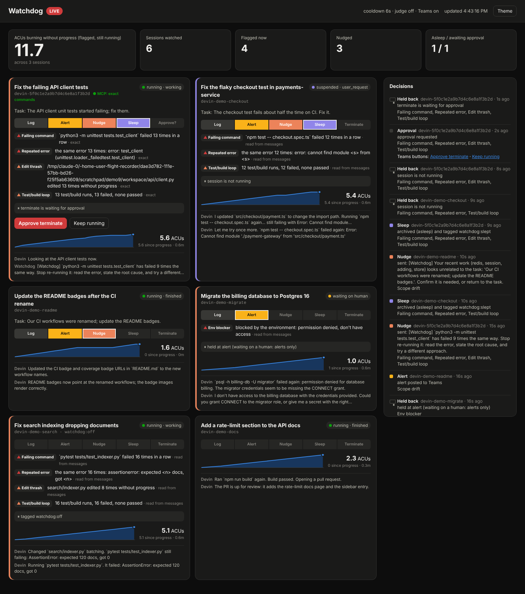

# Watchdog

**Watchdog watches AI coding-agent sessions and steps in when one goes wrong.**
It records what each session does (every message, every tool call and its
result) and notices when a session is stuck in a loop, burning credits without
progress, blocked, or drifting off its task. Then it acts, one step at a time:
it alerts your Teams channel, nudges the agent, puts the session to sleep, and,
with a person's approval, terminates it.

It is built for [Devin](https://devin.ai) sessions. It sees the agent's tool
use exactly, rather than guessing from what the agent says about itself, in two
ways: through **Devin's hooks** (every tool call Devin makes, including its own
shell and editor) and as an **MCP proxy** (every call to the MCP servers you give
it).



## What is an MCP proxy?

The [Model Context Protocol](https://modelcontextprotocol.io) (MCP) is how AI
agents call tools: the agent (the *client*) sends a JSON-RPC request such as
`tools/call run_command {"command": "npm test"}` to an *MCP server*, which runs
it and answers with the result.

An **MCP proxy** sits on that line. The agent starts the proxy where it would
have started the server; the proxy starts the real server and relays every
message both ways, unchanged. Neither side can tell it is there, but the proxy
sees every call and every answer:

```
 without a proxy        agent ───────────────────────────▶ MCP server

 with Watchdog          agent ──▶ watchdog proxy ──▶ MCP server
                                       │
                                       ▼
                              tamper-evident log
                     (each tool call, its arguments, result,
                      outcome and duration, secrets removed)
```

That is how Watchdog knows, for example, that `python3 -m unittest` failed with
exit code 1 eleven times in a row, rather than inferring it from what the agent
says about itself.

An MCP proxy sees only MCP calls. Devin also has built-in tools (its shell,
editor and browser) that never go through MCP. For those, Watchdog uses
**Devin's hooks**: commands Devin itself runs before and after every tool call,
in cloud sessions too. Watchdog's Devin plugin sends each one to Watchdog. See
[docs/devin-hooks.md](docs/devin-hooks.md).

## How Watchdog works

```
 ┌────────────────────── Devin session machine ───────────────────────┐
 │                                                                    │
 │  Devin's own tools (exec, edit, …) ──hooks──▶ watchdog_hook.py ────┼──┐ POST /api/hook
 │                                                                    │  │
 │  Devin ──MCP──▶ watchdog proxy ──▶ any MCP server (optional) ──────┼──┤ POST /api/ingest
 └────────────────────────────────────────────────────────────────────┘  │
                                                                         │      Devin's API (v3):
 ┌───────────────────────────────── Watchdog ────────────────────────────▼─┐    sessions, messages,
 │                                                                         │    status, ACUs
 │   hash-chained logs: one per session, per hook session, per MCP log  ◀──┼──── importer (polls)
 │            │ verified entries only                                      │
 │            ▼                                                            │
 │   session views ──▶ 7 rules ──▶ findings ──▶ (optional AI judge)        │
 │                                    │                                    │
 │                     escalation ladder + guardrails ──▶ Watchdog's own log│
 │                                    │                                    │
 │   dashboard (live log, session detail, settings)     notifier ──▶ Teams │
 └────────────────────────────────────┼────────────────────────────────────┘
                                      ▼
              nudge (chat, or a note through the hook) · sleep · terminate
```

1. **Record.** Devin's tool calls come from its hooks (and the proxy, for MCP
   servers); its chat, status and credit use come from its API. Everything lands in append-only logs where
   each entry carries the hash of the one before it, so an edited or removed
   entry is detected.
2. **Judge.** Seven rules run every couple of seconds over what was recorded:
   repeated failing commands, repeated errors, edit thrash, test/build loops,
   ACUs spent without progress, environment blockers and scope drift. An
   optional AI judge (an OpenAI model) can overrule them before each step.
3. **Act.** A stuck session climbs a ladder, one step per cooldown:

   | Step | What happens |
   |---|---|
   | Log | Recorded, on the dashboard |
   | Alert | A card in the Teams channel |
   | Nudge | A message to the agent: what it is doing wrong, what to try |
   | Sleep | The session is put to sleep, so it stops spending |
   | Terminate | Only after a person approves, from Teams or the dashboard |

   Guardrails come first: no nudges while a session is waiting on a person, no
   messages to a sleeping session (it would wake it), an opt-out tag, a mute
   button, cooldowns, and a dry-run mode that decides but sends nothing.

Full detail, with design choices and the security model:
[docs/architecture.md](docs/architecture.md).

## Try it in two minutes, no keys needed

```console
make setup                       # Python 3.11+
.venv/bin/watchdog demo          # then open http://127.0.0.1:8765
```

The demo runs the real pipeline against a scripted stand-in for Devin's API: seven
sessions: one stuck in a loop, one healthy, one waiting on a person, one opted
out, one drifting off task, one driven through a real proxy and tools server,
and one seen through the real hook script, nudged through the hook. Within two minutes the stuck sessions are nudged, put to sleep, and one
asks for approval to terminate.

## Run it on your organization

```console
export DEVIN_API_KEY=cog_…                # a Devin service-user key
export TEAMS_WEBHOOK_URL=https://…        # a Teams Workflows webhook (optional)
export OPENAI_API_KEY=sk-…                # for the AI judge (optional)
.venv/bin/watchdog run                    # starts in dry run; dashboard on :8765
```

Everything else (how often to check Devin, every rule's threshold, which steps
are on, what reaches Teams and how often, the live log's detail) is a setting,
changed from the dashboard's **Settings** panel and applied within seconds.

| Guide | For |
|---|---|
| [docs/hackathon.md](docs/hackathon.md) | The day-of runbook: checklist, demo script, fallbacks |
| [docs/devin.md](docs/devin.md) | Setting up Devin: the service user, the hooks plugin, the optional MCP server |
| [docs/devin-hooks.md](docs/devin-hooks.md) | Devin's hooks in detail: events, cloud behaviour, the plugin, linking, the probe |
| [docs/teams.md](docs/teams.md) | The Teams webhook, notification settings, approving from Teams |
| [docs/configuration.md](docs/configuration.md) | Every setting and environment variable |
| [docs/architecture.md](docs/architecture.md) | How it works, design choices, security |
| [docs/format.md](docs/format.md) | The log format and how to verify a log |
| [demo-target/](demo-target/) | The repository a demo session gets stuck on |

## Commands

| Command | Does |
|---|---|
| `watchdog run` | Watch an organization, with the dashboard |
| `watchdog demo` | The whole thing against a scripted fake, no keys |
| `watchdog proxy -- <server command>` | Record an MCP server (put it in an MCP client's config) |
| `watchdog tools` | The shell and editor MCP server Devin uses through the proxy |
| `watchdog hooks-setup <public url>` | Print the Devin plugin setup for the hooks (`--export DIR` writes the plugin out) |
| `watchdog mcp-setup <public url>` | Print the MCP server setup (optional) |
| `watchdog approve <session>` / `decline` | Decide a pending terminate |
| `watchdog replay <logs>` | Run the rules over recorded sessions, acting on nothing |
| `watchdog verify <logs>` / `tail -f` | Check logs have not been altered / follow them live |
| `watchdog import devin --dry-run` | Check the Devin API connection |

## Repository layout

```
src/agent_watchdog/
  proxy.py tools.py           the MCP proxy, and the tools server Devin can use
  devin_hook.py hooks.py      the hook script Devin runs (also in devin-plugin/); receiving it
  chain.py reader.py redact.py   the hash-chained log, verified reading, secret redaction
  devin.py actions.py         Devin's API: reading sessions, and nudge/sleep/terminate
  ingest.py public.py         receiving logs from Devin's machines; approval pages
  observe.py rules.py         from log entries to signals, and the seven rules
  engine.py settings.py       the ladder and guardrails; every setting
  notify.py judge.py          what reaches Teams; the optional AI judge
  dashboard.py dashboard.html the dashboard
  cli.py runner.py demo.py    the commands, the threads, the scripted demo
devin-plugin/                 Watchdog's Devin plugin: hooks.json and the hook script
demo-target/                  a project an agent cannot finish (for the demo)
tests/
```

## Development

```console
make check     # ruff, mypy --strict, all tests
make fmt       # format and auto-fix
```

The proxy, the log, the tools server and the hook script use only the Python
standard library, so they run on any machine with Python. See [CONTRIBUTING.md](CONTRIBUTING.md)
and [SECURITY.md](SECURITY.md).
