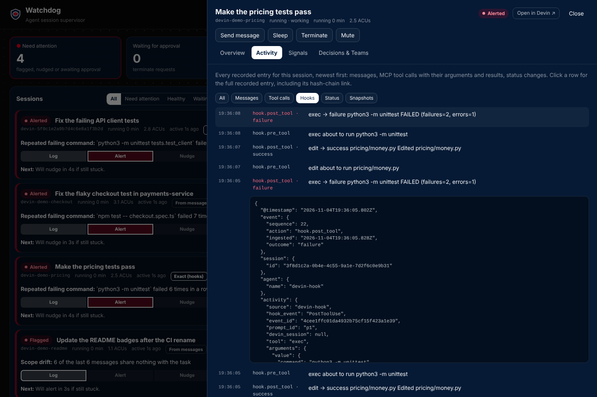

# Devin hooks: seeing what the agent actually does

Devin's API reports what a session *says*: its messages, status and credit use.
Devin's **hooks** report what it *does*. They fire before and after every tool
call, including Devin's own shell and editor, and they run in cloud sessions.
Watchdog's Devin plugin (`devin-plugin/`) uses them to send every tool call, with
its command, output and outcome, to Watchdog as it happens.



This is the recommended way to give Watchdog exact signals. It needs no
cooperation from the agent and nothing installed in Devin's environment beyond
`python3`. The `watchdog-tools` MCP server ([devin.md](devin.md)) is an
alternative that only sees the commands Devin chooses to run through it.

## What Devin's hooks are

From Devin's documentation (read 2026-11-04: *Hooks*, *Lifecycle Hooks*, the
*Plugins* guide and the CLI plugins reference, and the CLI changelog to
v3000.11.228, October 26, 2026).

A hook is a shell command Devin runs at a lifecycle event. It receives the event
as JSON on stdin and may answer on stdout.

| Event | Fires | Stdin carries |
|---|---|---|
| `PreToolUse` | before a tool runs | `tool_name`, `tool_input` (e.g. `{"command": "npm test"}`) |
| `PostToolUse` | after it finishes | `tool_name`, `tool_input`, `tool_response`: `success`, `output`, `error` |
| `UserPromptSubmit` | a person sends a message | `prompt` |
| `Stop` | the agent ends its turn | `stop_hook_active`; newer versions add `last_assistant_message` |
| `SessionStart` | a session starts or resumes | `source`: `startup` or `resume` |
| `PostCompaction` | after context compaction | `summary` |
| `PermissionRequest` | a permission decision is needed | `tool_name`, `tool_input` |
| `SessionEnd` | the session ends | **not fired in cloud sessions** |

Every payload also has a `session_id` (stable for the session) and a `prompt_id`
(one per turn).

**Tool names** (they "can vary by mode, model and integrations"):

| Kind | Names |
|---|---|
| Shell | `exec`, `get_output`, `write_to_process`, `kill_shell` |
| Files | `read`, `write`, `edit`, `apply_patch`, `notebook_read`, `notebook_edit` |
| Search, web | `grep`, `glob`, `webfetch` |
| Planning, skills, subagents | `todo_write`, `exit_plan_mode`, `skill`, `run_subagent`, `read_subagent` |
| MCP | `mcp__<server>__<tool>` |

**What a hook can answer**: block the action (`"decision": "block"` or exit
code 2); rewrite a tool's input (`updatedInput`); add text to the agent's
context (`additionalContext`, for `PostToolUse`, `UserPromptSubmit` and
`SessionStart`); and, in recent versions, replace a tool's result before the
model reads it (`updatedToolOutput`). Watchdog's hook uses only
`additionalContext`, for nudges, and never blocks or rewrites anything.

### In cloud sessions

- "The same events fire in the Devin CLI, Devin Desktop, and cloud sessions
  (through plugins)."
- Cloud sessions run **command** hooks only (prompt hooks are skipped) and don't
  fire `SessionEnd`.
- `SessionStart` runs on the session's VM once it is up, in the background (the
  agent doesn't wait for it), and **every wake from sleep is a resume**.
- Plugin hooks are "best effort and fail open": a hook that fails doesn't stop the
  session. Don't rely on them for guardrails. Watchdog doesn't: terminate still
  goes through the API, with a person's approval.
- Plugins are fetched at session start: changes apply to **new** sessions.

## How Watchdog's plugin works

```
 Devin session VM                                         Watchdog
 ────────────────                                         ────────
 Devin runs exec / edit / …
   │  PreToolUse, PostToolUse, UserPromptSubmit, Stop, SessionStart, PostCompaction
   ▼
 python3 hooks/watchdog_hook.py            POST /api/hook (bearer token)
   1. redact secrets, cap output  ───────────────────────────────▶ HookStore
   2. append to ~/.watchdog-hooks/spool.jsonl                       │ hook-<id>.ndjson
   3. send what is unsent (2 s timeout, 20 s backoff)               │ (hash-chained)
   4. print a waiting note as additionalContext  ◀── notes ─────────┤
                                                                    ▼
                                                    engine: exact commands, edits,
                                                    errors; linked to the Devin session
```

- **Never in the way.** The script exits 0 whatever happens. If Watchdog can't
  be reached, it spools the event locally and stops trying for 20 seconds. A
  Watchdog outage costs the agent at most one 2-second wait per 20 seconds, and
  no lost events.
- **Redaction first.** Secrets are removed with the same patterns Watchdog uses
  (a test keeps them identical) before anything is written or sent. Outputs
  longer than 20,000 characters keep their tail.
- **Tamper-evident on arrival.** Watchdog appends each event to a hash-chained
  log, one per hook session, and the engine reads it back verified, like every
  other log. The spool on Devin's machine is not chained: the chain starts when
  Watchdog receives an event.
- **Exact signals.** A `PostToolUse` for `exec` becomes a command with its
  outcome. The outcome comes from an exit code in the output if there is one,
  else from `success`. `edit`, `write` and `apply_patch` become edits of their
  files, and failures become error signatures and environment blockers. On the
  dashboard the session shows **Exact (hooks)**, and its findings say "exact".

### Which Devin session is it?

The docs don't say whether a cloud hook's `session_id` is the API's `devin-…`
id; their one example is a UUID. Watchdog handles both:

1. **A Devin id, if there is one.** If the hook's `session_id`, or any
   environment variable on the VM, contains a `devin-<hex>` id or an
   `app.devin.ai/sessions/<hex>` link, the script sends it, and Watchdog links
   the hook session to that Devin session.
2. **Otherwise, the first prompt.** The same message reaches Watchdog twice: from
   the `UserPromptSubmit` hook and from Devin's API. When exactly one Devin
   session has the same message (whitespace and case ignored), that is the
   one. If two sessions share it, nothing is linked.

Until a hook session is linked, it appears on the dashboard on its own and only
ever gets alerts. The decisions log says how each link was made.

### Nudging through the hook

**Settings → Escalation → Deliver nudges**: *Chat message* (the default), *Note
via hooks*, or *Both*.

With *Note via hooks*, the nudge waits in Watchdog until the session's next hook
call. It then arrives in the agent's context as `additionalContext` on its next
tool call, instead of as a chat message. Sessions without hook events fall back
to a chat message. The session detail page's *Send message* box can also send a
note this way.

## Set it up

Print the exact snippets for your public URL and repository:

```bash
.venv/bin/watchdog hooks-setup https://<public url> --repo <git URL of the Watchdog repo>
```

1. **The secret.** Devin → Settings → Secrets, organization scope:
   `WATCHDOG_INGEST_TOKEN`, the same value as on the Watchdog machine.
2. **The plugin, for the whole organization.** Devin → **Customize → Plugins →
   Plugin settings (gear) → Edit manifest**, Organization scope. Add to
   `requiredPlugins`:
   ```json
   {
     "source": "git-subdir",
     "url": "<git URL of the Watchdog repo>",
     "path": "devin-plugin",
     "env": {
       "WATCHDOG_HOOK_URL": "https://<public url>/api/hook",
       "WATCHDOG_INGEST_TOKEN": "secret:org:WATCHDOG_INGEST_TOKEN"
     }
   }
   ```
   The repository must be reachable through Devin's Git integration (Settings →
   Repositories).
3. **Or only one repository's sessions.** Add the same entry, without `env`,
   to that repository's `.devin/config.json`. The demo target ships an example.
   Devin documents plugin `env` for the managed manifest; check that a
   repository-level plugin receives it too. If it doesn't, use step 2.
4. **Start a new session.** Its card shows **Exact (hooks)** after its first
   tool call.

To keep the plugin in a repository of its own, export it:
`watchdog hooks-setup <url> --export ./watchdog-plugin`.

## Check it first: the probe

Some details aren't in Devin's docs. For example:
- whether `session_id` is the Devin id;
- which tool names cloud sessions use;
- whether `exec`'s `success` means exit code 0;
- which plugin-root variable is set.

A ten-minute probe answers them before you rely on the plugin:

1. **Customize → Hooks**, Organization scope → New hook. Paste the probe from
   [docs/hook-probe.json](hook-probe.json). It appends each payload, the
   *names* (not values) of the environment variables, and any `devin-…` ids it
   finds, to `~/watchdog-hook-probe.log` on the session's VM.
2. Start a session and ask Devin to run `ls`, then `false`, then edit a file,
   then `cat ~/watchdog-hook-probe.log`.
3. Remove the probe hook afterwards: payloads include command output.

What to look for:

| Question | Where in the log | If the answer is unexpected |
|---|---|---|
| Is `session_id` a `devin-…` id? | `session_id` in any payload | Prompt matching links it instead; nothing to change |
| Is a Devin id in the environment? | `devin ids in env:` | The plugin will pick it up automatically |
| Tool names for the shell and editor | `tool_name` | Tell me the names; they go in `observe.py`'s `_HOOK_SHELL` / `_HOOK_EDIT` |
| Does `success` follow the exit code for `false`? | the `PostToolUse` for `false` | If the output carries an exit code, Watchdog reads that first |
| Is the plugin root variable set? | `plugin root:` | The plugin's `hooks.json` tries `DEVIN_PLUGIN_ROOT`, then `PLUGIN_ROOT`, then `CLAUDE_PLUGIN_ROOT` |

## What this does not do

- It doesn't block, rewrite or slow down a tool call. The plugin only observes,
  plus optional notes.
- It can't see anything before the plugin loads, or sessions started before it
  was installed.
- Like any hook, it is best effort. If Devin skips a hook, Watchdog falls back
  to what the API shows for that session.
