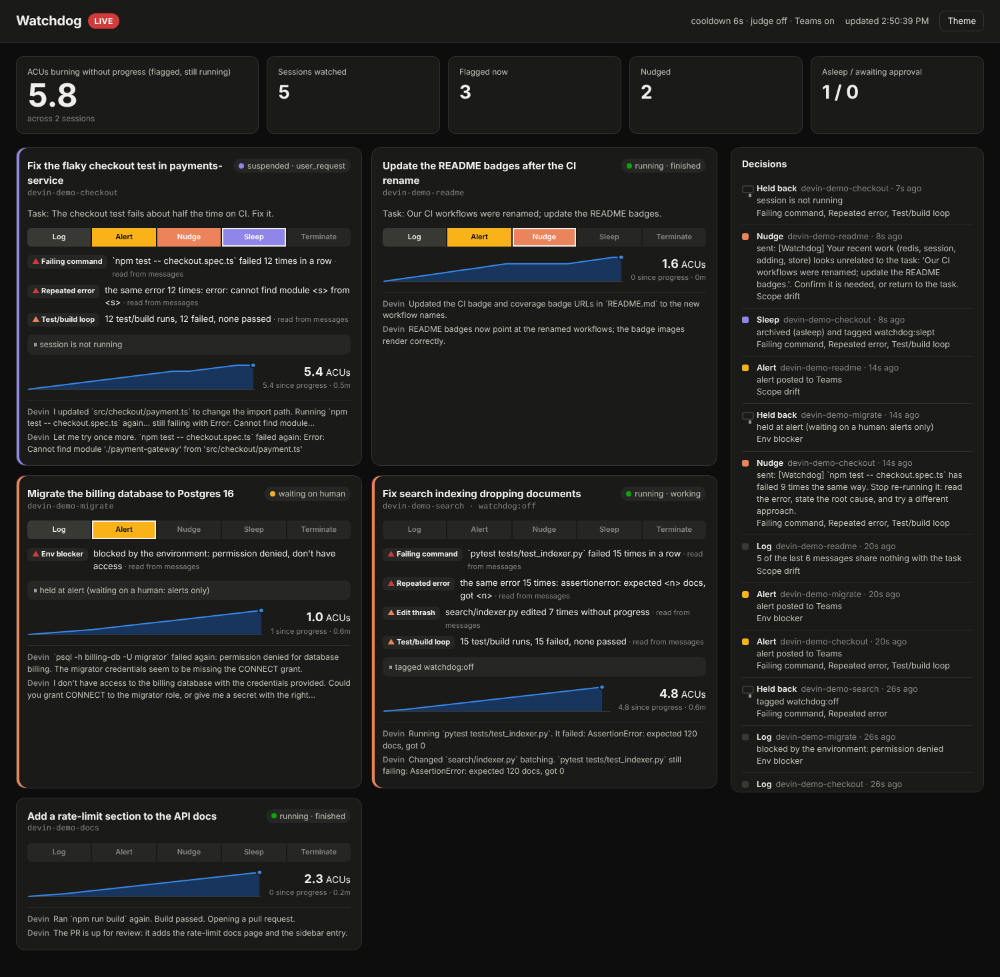

# Watchdog

Watchdog notices Devin sessions that are stuck or drifting off-task and still
spending ACUs, and does something about it: log → Teams alert → nudge → sleep →
terminate (with a person's approval).



## How it fits together

```
 Devin v3 API ──poll──▶ importer ──append──▶ session logs (hash-chained, verified)
 MCP servers ──proxy──────────────append──▶        │
                                                    ▼ reader.follow(): verified entries only
                                              SessionView per session
                                                    │
                                     7 rules ──▶ findings ──▶ (optional LLM judge)
                                                    │
                                    ladder + guardrails (SQLite state)
                                                    │
                 ┌───────────────┬─────────────────┼───────────────┐
             Teams card    nudge message      archive (sleep)   terminate*
                                                    │
                          watchdog-<session>.ndjson (its own chained log)
```

Two packages, one branch:

- **`flight_recorder`** records. The importer turns Devin's API into chained
  logs; the proxy does the same for MCP tool calls. It never acts.
- **`devin_watchdog`** judges and acts. It reads only verified log entries, never
  the API directly, so the record of what it saw is the record of what it acted
  on. Its own decisions go into a chained log too.

That split is the main design choice, and the main change from the October 19
plan (one poller reading the API straight into SQLite). What it buys:

- **Replay.** `watchdog replay <logs>` runs the rules over recorded sessions and
  prints what Watchdog would have done. Tune thresholds against real sessions
  before switching off DRY_RUN.
- **An audit trail.** Every nudge, sleep and terminate has a tamper-evident
  record of the findings and the evidence behind it. That matters most for
  terminate.
- **One code path for every source.** Devin's API, MCP servers through the
  proxy, and any future `shell.command` source all become the same entries.
- **A demo that is not a mock-up.** `watchdog demo` runs the real importer and
  engine against a fake API over HTTP.

## Signals: what Devin's API gives you

Devin's v3 API exposes, per session: `status` (`new`, `claimed`, `running`,
`exit`, `error`, `suspended`, `resuming`), `status_detail` (`working`,
`waiting_for_user`, `waiting_for_approval`, `finished`, or a suspension reason),
`acus_consumed`, `pull_requests`, `tags`, and the chat messages (`source` is
`devin` or `user`). It does **not** expose the shell commands, file edits or
tool calls a session made.

So:

| Source | Exact or heuristic | Feeds |
|---|---|---|
| Session status, ACUs, PRs, tags | exact | ACUs-without-progress, guardrails |
| Devin's messages ("Running `npm test`… failed: Error: …") | **heuristic**: commands in backticks, failure words, error lines, edited paths | failing commands, errors, edit thrash, loops, env blockers, drift |
| MCP servers given to Devin, through `flight-recorder proxy` | exact, with outcomes | failing commands, errors, edits |
| `shell.command` / `file.edit` entries, if a source ever provides them | exact | the same |

The dashboard marks findings that came from message text ("read from
messages"). If the MCP route is open to you, giving Devin a shell or editor MCP
server through the proxy turns the heuristic rules into exact ones.

## The seven rules

All thresholds are in `rules.Thresholds`. A rule only looks at what happened
since the later of one window ago (30 min) and the session's last progress: a
test or build passing, a PR opening or changing, a person replying, or
`status_detail` becoming `finished`. A recovering session stops matching on its
own.

| Rule | Fires when (defaults) | Ceiling |
|---|---|---|
| `repeated_failing_commands` | the same command (numbers and hashes normalised) fails 3 times with no success in between | terminate |
| `repeated_errors` | the same error signature (paths, quotes and numbers normalised) 3 times | terminate |
| `edit_thrash` | the same file edited 5 times without progress | terminate |
| `test_build_loop` | 4 test/build runs, none passing, at least half failing | terminate |
| `acus_without_progress` | ≥ 5 ACUs over ≥ 20 min since the last progress, while running | terminate |
| `environment_blocker` | 2 mentions of permission denied, missing credentials, command not found, rate limits, no space… | terminate |
| `scope_drift` | 5 of the last 6 Devin messages share no content word with the task (its first user message, title and Devin's first reply) | **nudge** |

Scope drift is the weakest signal, so on its own it never goes past a nudge. It
is the rule the LLM judge helps most.

## The ladder and its guardrails

One rung per cooldown (default 10 min) while a session keeps matching. Back to
the start after 30 minutes with no findings.

| Rung | What happens |
|---|---|
| log | Recorded in Watchdog's log and on the dashboard |
| alert | An Adaptive Card to the Teams webhook, with the rules, the evidence, ACUs and a link to the session |
| nudge | `POST /v3/organizations/{org}/sessions/{id}/messages`: the judge's nudge, or the worst finding's. It always starts with `[Watchdog]`, so Watchdog never mistakes its own message for a person replying |
| sleep | `POST …/archive`, which the API documents as "archive session and put it to sleep if currently running". Then the session is tagged `watchdog:slept` |
| terminate | An approval request (Teams card and dashboard button). `DELETE …/sessions/{id}` only after `watchdog approve <id>` or the dashboard button |

Checked in this order, every tick:

1. **Running only.** A suspended session is never nudged: the API wakes a
   session to deliver a message, so a nudge would undo the sleep.
2. **`watchdog:off` tag.** Logged once, then left alone.
3. **Pending approval.** Nothing more until someone decides.
4. **Cooldown** between rungs.
5. **Ceilings.** A rule's own ceiling (drift stops at nudge). A session
   **waiting on a human** (`waiting_for_user`, `waiting_for_approval`) gets
   alerts only. Sessions that are not Devin's (MCP proxy sessions) get alerts
   only.
6. **The judge**, if configured, can veto the step. The veto holds for a
   cooldown.
7. **DRY_RUN** (the default): nothing is sent to Devin. Teams alerts still go
   out, marked dry run. The ladder still advances, so you see exactly what it
   would have done.

A log that fails verification stops Watchdog acting altogether, and it alerts.

## The LLM judge (optional)

`--judge-model claude-opus-5-5` (or `WATCHDOG_JUDGE_MODEL`). It is called only
when a rule fires and Watchdog is about to step up. It gets the task, the
findings and the last 40 observations, and answers with structured JSON:
`stuck`, `confidence`, `reason`, `nudge`. A confident "not stuck" holds
Watchdog back. A "stuck" verdict supplies the nudge text. An error or a refusal
leaves the rules in charge. Verdicts are cached per session and set of rules for
a cooldown, so a session that stays stuck costs one call per cooldown.

Session text goes to the judge inside `<session>` and is declared as data.
Session content is agent-written, so a prompt injection is possible. The worst
it can do is make the judge hold Watchdog back. It can never push Watchdog past
what the rules allow.

Needs `pip install '.[judge]'` and `ANTHROPIC_API_KEY`.

## Running it

A Devin **service user** (see Devin's API quick start) with `ViewOrgSessions`, and
`ManageOrgSessions` for nudge, sleep and terminate. Its key starts `cog_`.

```console
export DEVIN_API_KEY=cog_…               # environment only, never a flag
export DEVIN_ORG_ID=org-…                 # optional: found from the key via /v3/self
export TEAMS_WEBHOOK_URL=https://…        # a Teams Workflows webhook URL
watchdog run                              # DRY RUN; dashboard on http://127.0.0.1:8765
watchdog run --live                       # act on sessions
watchdog approve devin-1a2b3c             # allow a pending terminate
watchdog replay ~/.local/share/flight-recorder --cooldown 600
```

Or in Docker (SQLite and logs on a volume):

```console
DEVIN_API_KEY=cog_… WATCHDOG_APPROVAL_TOKEN=… docker compose up -d watchdog
```

| Environment | Meaning |
|---|---|
| `DEVIN_API_KEY` | Service-user key (`cog_…`) |
| `DEVIN_ORG_ID` | Organization; default: the key's own |
| `TEAMS_WEBHOOK_URL` | Teams incoming webhook; without it, alerts are only logged |
| `WATCHDOG_DRY_RUN` | `1` (default) or `0`; `--live` overrides it |
| `WATCHDOG_JUDGE_MODEL` | Turns the judge on, with this model |
| `WATCHDOG_APPROVAL_TOKEN` | Required by the dashboard's approve button when it is not on loopback |
| `ANTHROPIC_API_KEY` | For the judge |

## The hackathon demo

```console
make setup
.venv/bin/watchdog demo                   # dashboard on http://127.0.0.1:8765
.venv/bin/watchdog demo --judge-model claude-opus-5-5   # with the judge (needs ANTHROPIC_API_KEY)
docker compose run --rm --service-ports demo           # the same, in Docker
```

Five scripted sessions on a local fake of the v3 API, a step every 4 seconds,
cooldown 12 seconds. The whole story takes about a minute:

| Session | What it shows |
|---|---|
| **checkout** | Deliberately stuck: the same failing `npm test`, the same error, ACUs climbing. Logged at ~12 s, alert, nudge (it says "Understood" and carries on), then **asleep** at ~50 s. This is the "done" criterion |
| **docs** | Healthy: builds pass, a PR opens, it finishes. Never flagged |
| **migrate** | Blocked by permissions, then waiting on a human: alerted, held at alert, no nudge |
| **search** | Just as stuck as checkout, but tagged `watchdog:off`: held, never touched |
| **readme** | Drifts into rewriting auth middleware, gets nudged, comes back on task, recovers |

Suggested talk track: open on the hero number (ACUs burning without progress).
Follow checkout up the ladder. Point at the decisions feed and the four sessions
it chose *not* to touch, and why. End on the chained log:

```console
flight-recorder verify <demo dir>/logs <demo dir>/logs/watchdog
```

For the live version, start a real Devin session with a task it cannot finish
(for example "make `npm test` pass" in a repo whose test imports a module that
does not exist), run `watchdog run --live --cooldown 120`, and watch it climb.

## Known gaps

- **Real API calls not yet exercised.** Everything is written against Devin's
  published v3 OpenAPI spec and tested against a fake built from it. Run
  `flight-recorder import devin --dry-run` with a real key first.
- **Sleep is archive.** The API has no separate sleep endpoint. An archived
  session may drop out of the default list view; Watchdog tags it
  `watchdog:slept` so it can be found.
- **The heuristic rules see only what Devin says**, not what it runs. See
  "Signals" above.
- **One poll a minute** by default, listing sessions updated since the last poll.
  Devin has no outbound session-event webhook in the v3 API, so polling it is.
